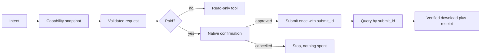

# Dreamina Design

## Plugin marketplaces

This plugin belongs to **AIGC content creation**.

| Category | Marketplace | Purpose |
| --- | --- | --- |
| Full-stack development | [Full Stack Plugins](https://github.com/partme-ai/full-stack-plugins) | Architecture and UI design, code understanding, quality checks, code review, workflow governance, and server operations |
| AIGC content creation | [Full AIGC Plugins](https://github.com/partme-ai/full-aigc-plugins) | Image, video, audio, music, 3D, and multimodal content creation |


> Create and edit Dreamina images and videos from your coding agent, with a capability snapshot from the live CLI, one explicit approval per paid call, and submissions you can resume by identifier.

[](https://github.com/full-aigc-plugins/dreamina-design-plugin/releases) [](#skills) [](#mcp-tools) [](LICENSE)

[English](README.md) | [简体中文](README.zh-CN.md) · [Install](#installation) · [Quick start](#quick-start) · [Skills](#skills) · [MCP tools](#mcp-tools) · [Troubleshooting](#troubleshooting)

## Positioning

`dreamina-design` is a strict wrapper around the official Dreamina CLI. It discovers what the installed CLI can actually do, validates each generation request against that snapshot, asks for a native confirmation before any paid call, and queries an uncertain task by its `submit_id` instead of submitting again. No tool accepts free-form shell input.

Since `0.7.0` the plugin runs a **dual rail**: paid submit tools default to the Canvas runtime (`dreamina-canvas` CLI with quote-bound approval), while `runtime: "legacy"` keeps the frozen `dreamina` path. The legacy binary stops being maintained after **2026-11**, so new work should use the Canvas rail.

## Installation

### Prerequisites

- Python 3.13 for the MCP server.
- The `dreamina-canvas` CLI, enrolled and trusted with an absolute path and SHA-256 digest. The legacy `dreamina` CLI is optional and only for the frozen rail.
- Optional, reference-video project tools only: `ffmpeg`, `ffprobe`, a Whisper-compatible ASR runtime, and macOS `say`.
- A Dreamina account with credits; generation spend is never included in the plugin.

### From the plugin marketplace

```bash
codex plugin marketplace add partme-ai/full-aigc-plugins
codex plugin add dreamina-design@full-aigc-plugins
```

Restart the host and open a new task. Then confirm the server and the CLI trust record:

```bash
codex mcp list
```

Read-only tools run without a prompt; paid and mutating tools raise a native confirmation whose default action is Cancel.

## Quick start



```text
Create a Dreamina image from this brief: a matte ceramic teapot on a linen table,
soft morning light. Show the exact parameters before you spend anything.
```

Expected observation: a capability snapshot, a validated request, a confirmation dialog listing the exact parameters, then a single submission with a `submit_id`. Asking to query it downloads the artifact and verifies it on arrival.

## What you can build

| Workflow | Built-in path | Verifiable output |
| --- | --- | --- |
| Image generation and edits | `dreamina-prompt-text2image`, `dreamina-prompt-image2image`, `dreamina-submit_image` | Submitted task plus verified image |
| Video generation | `dreamina-prompt-text2video`, `dreamina-prompt-image2video`, `dreamina-submit_video` | Submitted task plus verified video |
| Iterate toward a target | `dreamina-visual-target`, `dreamina-vision-judge`, `dreamina-visual-loop` | Target receipt, round receipt, judge verdict |
| Full video project | `dreamina-video-production`, `dreamina-video-shots`, `dreamina-video-evaluator`, `dreamina-video-sync` | Shot analysis, evaluated batches, composed export |
| Browser-only members | `dreamina-opencli-text2image`, `dreamina-opencli-image2image`, `dreamina-opencli-text2video`, `dreamina-opencli-image2video` | Generated artifacts through the Jimeng web session |

## Skills

| Skill | What it does |
| --- | --- |
| `dreamina-design-use` | Routes an unspecified image or video request to the right entry point. |
| `dreamina-design-harness` | Invocation spec: generation families, shot annotation, evaluation and paid submit-once gates. |
| `dreamina-auto-seedance` | Turns a validated DCC preview into an approved Seedance video. |
| `dreamina-seedance-resume` | Resumes a paused 3D job from its ledger state without re-paying. |
| `dreamina-prompt-text2image` | Writes and refines image-generation prompts. |
| `dreamina-prompt-image2image` | Writes edit prompts for style, background, detail, colour and compositing. |
| `dreamina-prompt-text2video` | Writes video prompts with motion and camera direction. |
| `dreamina-prompt-image2video` | Covers single-image, first-last frame, storyboard and multimodal reference modes. |
| `dreamina-vision-judge` | Scores a candidate against a target on composition, lighting, materials and detail, out of ten. |
| `dreamina-visual-target` | Obtains or synthesizes the target image a visual loop needs. |
| `dreamina-video-production` | Runs a complete video project from a local reference video. |
| `dreamina-video-shots` | Breaks a finished clip into a measured shot table with deterministic gates. |
| `dreamina-video-sync` | Composites shot metadata onto the source video so it cuts with the picture. |
| `dreamina-shot-annotator` | Produces shot-annotation schema content only. |
| `dreamina-video-evaluator` | Produces shot-evaluation schema content only. |
| `dreamina-opencli-text2image` | Automates Jimeng text-to-image for standard members through the browser bridge. |
| `dreamina-opencli-image2image` | Browser-bridge image editing when no CLI is available. |
| `dreamina-opencli-text2video` | Browser-bridge text-to-video for standard members. |
| `dreamina-opencli-image2video` | Browser-bridge image animation with manual reference upload. |
| `dreamina-cli-text2image` | Frozen legacy CLI route; only for explicit legacy recovery. |
| `dreamina-cli-image2image` | Frozen legacy CLI route for image edits. |
| `dreamina-cli-text2video` | Frozen legacy CLI route for text-to-video. |
| `dreamina-cli-image2video` | Frozen legacy CLI route for image-to-video. |
| `dreamina-cli` | Frozen compatibility entry; new tasks move to the Canvas successor. |

## Slash commands

| Command | What it does |
| --- | --- |
| `/dreamina` | Entry point; routes text/image and video families. |
| `/dreamina-setup` | First-run setup: CLI install, authentication and preflight. |
| `/dreamina-text2image` | Submit, poll and troubleshoot image generation. |
| `/dreamina-image2image` | Local edits, stylization and upscale. |
| `/dreamina-text2video` | Text-to-video including Seedance. |
| `/dreamina-image2video` | Reference image, video or audio driven generation. |
| `/dreamina-prompt` | Prompt refinement across the four modes. |
| `/dreamina-visual-loop` | Target lock → paid generation → independent review → bounded retry. |
| `/dreamina-auto-seedance` | Validated preview → one submit → verified download. |
| `/dreamina-seedance-resume` | Resume a paused Seedance job from the ledger. |
| `/dreamina-video-production` | Reference video → analysis → prompts → submit → evaluation. |

## MCP tools

`.mcp.json` declares one stdio server, `dreamina_design`, started with `python3 -m scripts.dreamina_mcp_server`. It exposes 22 typed tools; read-only ones are pre-approved and paid ones always prompt.

| Group | Tools |
| --- | --- |
| Read-only | `dreamina_capability_snapshot`, `dreamina_cli_status`, `dreamina_account`, `dreamina_query_task`, `dreamina_list_tasks`, `dreamina_diagnose`, `dreamina_quote_video_batch` |
| Paid or mutating | `dreamina_submit_image`, `dreamina_submit_video`, `dreamina_visual_loop`, `dreamina_cli_install_or_upgrade`, `dreamina_auth`, `dreamina_session` |
| Video project | `dreamina_video_project`, `dreamina_analyze_reference_video`, `dreamina_validate_shot_analysis`, `dreamina_create_redesign`, `dreamina_evaluate_video_batch` |
| Batch and export | `dreamina_approve_video_batch`, `dreamina_execute_video_batch`, `dreamina_compose_video`, `dreamina_export_video_project` |

Failures return a structured envelope with `error_type`, `message`, `retryable`, `requires_user_action` and a `next_action` of `request_user_action`, `query_same_submit_id` or `correct_request`.

## Configuration

| Setting | Location | Notes |
| --- | --- | --- |
| MCP server | `.mcp.json` | stdio; 10-second startup timeout, 3600-second tool timeout |
| Trusted CLI record | `~/.config/dreamina-design/trusted-cli.json` | Mode `0600`; stores path and digest, never a credential |
| State root | `~/.local/share/dreamina-design/` | Holds `operations/` and `approvals/` |
| CLI logs | `~/.dreamina_cli/logs` | Read only through the bounded, redacted diagnostic tool |

## Architecture and security

Codex owns orchestration and approvals; the Dreamina CLI owns authentication and the remote API; this plugin owns validation, approval receipts and the operation ledger. The authors receive no artifact.

- A paid call requires a native confirmation bound to the session and request; receipts are single-use and expire after five minutes.
- CLI trust requires an absolute non-symlink path, a trusted owner and mode, and a SHA-256 digest.
- Approval persistence strips credential-like keys before writing; diagnostics are bounded and redacted.
- Reference-video uploads are contained: at most 50 MiB per image and 512 MiB per media file.

| Evidence | Status |
| --- | --- |
| CLI runtime contract, existing-task recovery | Recorded in `docs/verification/dreamina-cli-runtime.md` |
| Paid canary | Separately approved and recorded in `docs/verification/paid-canary-2026-09-13.md` |
| Reference-video project chain | Registered, but the ten runtime gate lines are `NOT_RUN` |

## Troubleshooting

| Symptom | Check first | Resolution |
| --- | --- | --- |
| Tools are missing | `codex mcp list` | Enable the plugin and open a new task |
| A paid call is blocked | The confirmation dialog | Confirm explicitly; the default is Cancel |
| The CLI is not trusted | The trust record | Re-enrol the CLI and confirm the digest |
| A task looks stuck | The task state | Query by `submit_id`; never submit again |
| A video mode is refused | Web-side prerequisites | Complete the prerequisite on the web; the plugin will not bypass it |
| A reference-video tool does nothing | The runtime gate record | Those gate lines are `NOT_RUN` until they pass |

## Upgrade

```bash
codex plugin marketplace upgrade full-aigc-plugins
codex plugin add dreamina-design@full-aigc-plugins
```

Re-run the capability snapshot after upgrading: model parameters and command help come from the installed CLI, not from this repository. If you still call `runtime: "legacy"`, plan the move to the Canvas rail before the 2026-11 sunset.

Current packaged version: `0.8.1+codex.20261018` (development preview).

## Contributing and support

Open functional issues at <https://github.com/full-aigc-plugins/dreamina-design-plugin/issues>. State the CLI version you verified against, whether the change alters the approval envelope or the receipt format, and include the affected gate output.

## License

Apache-2.0 — see [LICENSE](LICENSE), [NOTICE](NOTICE) and [THIRD_PARTY_NOTICES.md](THIRD_PARTY_NOTICES.md).
