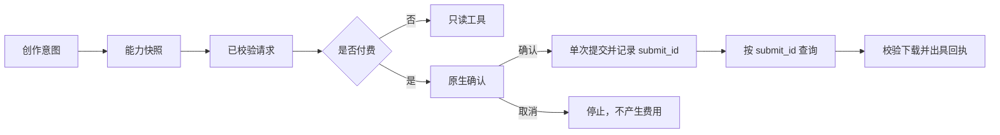

# Dreamina Design

## 插件市场导航

本插件所属分类：**AIGC 内容创作**。

| 分类 | 插件市场入口 | 用途 |
| --- | --- | --- |
| 全栈开发 | [Full Stack Plugins](https://github.com/partme-ai/full-stack-plugins) | 架构与 UI 设计、代码理解、质量检查、代码审查、流程治理与服务器运维 |
| AIGC 内容创作 | [Full AIGC Plugins](https://github.com/partme-ai/full-aigc-plugins) | 图像、视频、音频、音乐、3D 与多模态内容创作 |


> 在编码智能体里生成与编辑即梦图像、视频：能力清单来自已安装的 CLI，每次付费都需明确确认，提交身份可按标识续查。

[](https://github.com/full-aigc-plugins/dreamina-design-plugin/releases) [](#技能) [](#mcp-工具) [](LICENSE)

[English](README.md) | [简体中文](README.zh-CN.md) · [安装](#安装) · [快速开始](#快速开始) · [技能](#技能) · [MCP 工具](#mcp-工具) · [故障排查](#故障排查)

## 项目定位

`dreamina-design` 是官方 Dreamina CLI 的严格包装。它先弄清已安装 CLI 实际具备哪些能力，再按这份快照校验每个生成请求；任何付费调用都要经过原生确认对话框；结果不明时按 `submit_id` 查询，而不是重新提交。没有任何工具接受自由拼接的 shell 输入。

自 `0.7.0` 起插件采用**双轨**：付费提交工具默认走 Canvas 运行时（`dreamina-canvas` CLI，报价绑定审批），`runtime: "legacy"` 保留冻结的 `dreamina` 路径。旧二进制将在 **2026-11** 之后停止维护，新任务请使用 Canvas 轨。

## 安装

### 前置条件

- MCP server 需要 Python 3.13。
- 已安装 `dreamina-canvas` CLI，并以绝对路径与 SHA-256 摘要完成信任登记。旧 `dreamina` CLI 仅在冻结轨上可选。
- 仅参考视频项目工具需要：`ffmpeg`、`ffprobe`、兼容 Whisper 的 ASR 运行时，以及 macOS 的 `say`。
- 具备积分的即梦账号；生成费用不包含在插件内。

### 从插件市场安装

```bash
codex plugin marketplace add partme-ai/full-aigc-plugins
codex plugin add dreamina-design@full-aigc-plugins
```

重启宿主并新建任务，然后确认 server 与 CLI 信任记录：

```bash
codex mcp list
```

只读工具不会弹窗；付费与变更类工具会弹出原生确认，默认动作是取消。

## 快速开始



```text
用即梦按这个需求生成一张图：亚麻桌布上的哑光陶瓷茶壶，清晨柔光。
花钱之前先把完整参数给我看。
```

预期现象：先生成能力快照，再校验请求，随后弹出列出完整参数的确认框，最后只提交一次并返回 `submit_id`。再要求查询时，会下载产物并在落盘时校验。

## 可完成的工作

| 工作流 | 内置路径 | 可验证输出 |
| --- | --- | --- |
| 图像生成与编辑 | `dreamina-prompt-text2image`、`dreamina-prompt-image2image`、`dreamina-submit_image` | 已提交任务与校验过的图像 |
| 视频生成 | `dreamina-prompt-text2video`、`dreamina-prompt-image2video`、`dreamina-submit_video` | 已提交任务与校验过的视频 |
| 向目标图迭代 | `dreamina-visual-target`、`dreamina-vision-judge`、`dreamina-visual-loop` | 目标回执、轮次回执、评审结论 |
| 完整视频项目 | `dreamina-video-production`、`dreamina-video-shots`、`dreamina-video-evaluator`、`dreamina-video-sync` | 镜头分析、批次评估、合成导出 |
| 仅网页端会员 | `dreamina-opencli-text2image`、`dreamina-opencli-image2image`、`dreamina-opencli-text2video`、`dreamina-opencli-image2video` | 通过即梦网页会话产出的文件 |

## 技能

| 技能 | 作用 |
| --- | --- |
| `dreamina-design-use` | 把未指定入口的图像/视频请求路由到合适技能。 |
| `dreamina-design-harness` | 调用规范：生成场景、镜头标注、评估与付费一次提交门禁。 |
| `dreamina-auto-seedance` | 把已校验的 DCC 预览转成经批准的 Seedance 视频。 |
| `dreamina-seedance-resume` | 按账本状态续跑暂停的 3D 作业，不重复付费。 |
| `dreamina-prompt-text2image` | 编写与打磨文生图提示词。 |
| `dreamina-prompt-image2image` | 编写风格、背景、细节、色彩与合成的图生图提示词。 |
| `dreamina-prompt-text2video` | 编写带运动与运镜描述的视频提示词。 |
| `dreamina-prompt-image2video` | 覆盖单图、首尾帧、故事板与多模态参考四种模式。 |
| `dreamina-vision-judge` | 按构图、光线、材质、细节四个维度给候选图与目标图打分。 |
| `dreamina-visual-target` | 为视觉循环取得或生成目标图。 |
| `dreamina-video-production` | 从本地参考视频跑完整视频项目。 |
| `dreamina-video-shots` | 把成片拆成可度量的镜头表，并用确定性门禁校验。 |
| `dreamina-video-sync` | 把镜头信息合成到原片上，切换镜头时信息同步切换。 |
| `dreamina-shot-annotator` | 只产出镜头标注 schema 内容。 |
| `dreamina-video-evaluator` | 只产出镜头评估 schema 内容。 |
| `dreamina-opencli-text2image` | 标准会员经浏览器桥完成即梦文生图。 |
| `dreamina-opencli-image2image` | 无 CLI 时经浏览器桥做图像编辑。 |
| `dreamina-opencli-text2video` | 标准会员经浏览器桥完成文生视频。 |
| `dreamina-opencli-image2video` | 浏览器桥图片动效，参考图需手动上传。 |
| `dreamina-cli-text2image` | 冻结的旧 CLI 路径，仅用于显式兼容恢复。 |
| `dreamina-cli-image2image` | 冻结的旧 CLI 图像编辑路径。 |
| `dreamina-cli-text2video` | 冻结的旧 CLI 文生视频路径。 |
| `dreamina-cli-image2video` | 冻结的旧 CLI 图生视频路径。 |
| `dreamina-cli` | 冻结兼容入口；新任务转交 Canvas 后继技能。 |

## 斜杠命令

| 命令 | 作用 |
| --- | --- |
| `/dreamina` | 总入口：路由图像/视频各类家族。 |
| `/dreamina-setup` | 首次配置：CLI 安装、鉴权与预检。 |
| `/dreamina-text2image` | 文生图提交、轮询与排障。 |
| `/dreamina-image2image` | 局部重绘、风格化与放大。 |
| `/dreamina-text2video` | 文生视频，含 Seedance。 |
| `/dreamina-image2video` | 参考图、视频或音频驱动的生成。 |
| `/dreamina-prompt` | 四种模式的提示词打磨。 |
| `/dreamina-visual-loop` | 锁定目标 → 付费生成 → 独立评审 → 受额度约束的重试。 |
| `/dreamina-auto-seedance` | 已校验预览 → 一次提交 → 校验下载。 |
| `/dreamina-seedance-resume` | 按账本续跑暂停的 Seedance 作业。 |
| `/dreamina-video-production` | 参考视频 → 分析 → 提示词 → 提交 → 评估。 |

## MCP 工具

`.mcp.json` 声明一个 stdio server：`dreamina_design`，由 `python3 -m scripts.dreamina_mcp_server` 启动。它提供 22 个类型化工具：只读工具预授权，付费工具必定弹窗。

| 分组 | 工具 |
| --- | --- |
| 只读 | `dreamina_capability_snapshot`、`dreamina_cli_status`、`dreamina_account`、`dreamina_query_task`、`dreamina_list_tasks`、`dreamina_diagnose`、`dreamina_quote_video_batch` |
| 付费或变更 | `dreamina_submit_image`、`dreamina_submit_video`、`dreamina_visual_loop`、`dreamina_cli_install_or_upgrade`、`dreamina_auth`、`dreamina_session` |
| 视频项目 | `dreamina_video_project`、`dreamina_analyze_reference_video`、`dreamina_validate_shot_analysis`、`dreamina_create_redesign`、`dreamina_evaluate_video_batch` |
| 批次与导出 | `dreamina_approve_video_batch`、`dreamina_execute_video_batch`、`dreamina_compose_video`、`dreamina_export_video_project` |

失败返回结构化信封，含 `error_type`、`message`、`retryable`、`requires_user_action`，以及 `next_action`（`request_user_action`、`query_same_submit_id` 或 `correct_request`）。

## 配置

| 设置 | 位置 | 说明 |
| --- | --- | --- |
| MCP server | `.mcp.json` | stdio；启动超时 10 秒，工具超时 3600 秒 |
| CLI 信任记录 | `~/.config/dreamina-design/trusted-cli.json` | 权限 `0600`，只存路径与摘要，不存凭据 |
| 状态根目录 | `~/.local/share/dreamina-design/` | 包含 `operations/` 与 `approvals/` |
| CLI 日志 | `~/.dreamina_cli/logs` | 只能通过有界且脱敏的诊断工具读取 |

## 架构与安全

Codex 负责编排与审批，Dreamina CLI 负责鉴权与远端 API，本插件负责校验、审批回执与操作账本；作者不接收任何产物。

- 付费调用需要与会话和请求绑定的原生确认；回执一次性使用，五分钟过期。
- CLI 信任要求绝对路径、非符号链接、可信所有者与权限，并校验 SHA-256 摘要。
- 审批记录落盘前会剔除凭据类字段；诊断有界并脱敏。
- 参考视频上传受限：单张图片最多 50 MiB，单个媒体文件最多 512 MiB。

| 证据 | 状态 |
| --- | --- |
| CLI 运行时契约、既有任务恢复 | 记录于 `docs/verification/dreamina-cli-runtime.md` |
| 付费金丝雀 | 单独批准并记录于 `docs/verification/paid-canary-2026-09-13.md` |
| 参考视频项目链路 | 已注册，但十条运行时门禁行均为 `NOT_RUN` |

## 故障排查

| 现象 | 先检查 | 处理 |
| --- | --- | --- |
| 工具缺失 | `codex mcp list` | 启用插件并新建任务 |
| 付费调用被拦截 | 确认对话框 | 明确确认；默认动作是取消 |
| CLI 未被信任 | 信任记录 | 重新登记并确认摘要 |
| 任务看似卡住 | 任务状态 | 按 `submit_id` 查询，绝不重复提交 |
| 某个视频模式被拒 | 网页端前置条件 | 先在网页完成前置条件，插件不会绕过 |
| 参考视频工具无反应 | 运行时门禁记录 | 在门禁通过前，这些行保持 `NOT_RUN` |

## 升级

```bash
codex plugin marketplace upgrade full-aigc-plugins
codex plugin add dreamina-design@full-aigc-plugins
```

升级后重新拉取能力快照：模型参数与命令帮助来自已安装的 CLI，而不是本仓库。若仍在使用 `runtime: "legacy"`，请在 2026-11 停维前规划迁移到 Canvas 轨。

当前打包版本：`0.8.1+codex.20261018`（开发预览）。

## 贡献与支持

功能问题请提交到 <https://github.com/full-aigc-plugins/dreamina-design-plugin/issues>。说明你验证所用的 CLI 版本、改动是否触及审批信封或回执格式，并附上受影响的门禁输出。

## 许可证

Apache-2.0，详见 [LICENSE](LICENSE)、[NOTICE](NOTICE) 与 [THIRD_PARTY_NOTICES.md](THIRD_PARTY_NOTICES.md)。
